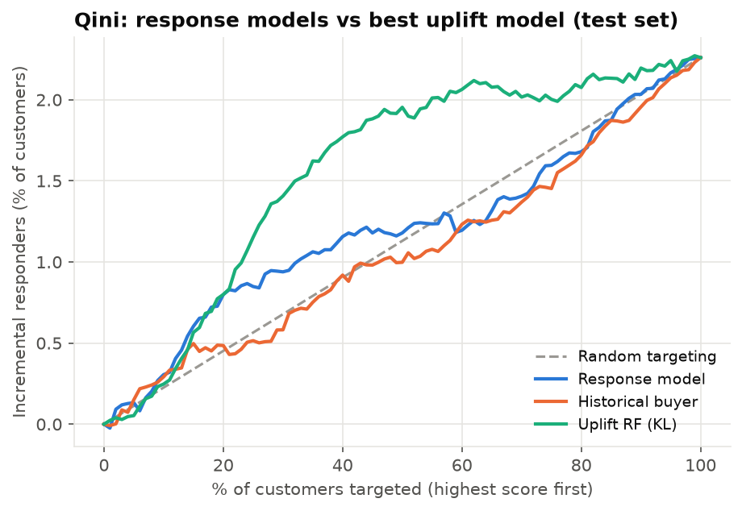
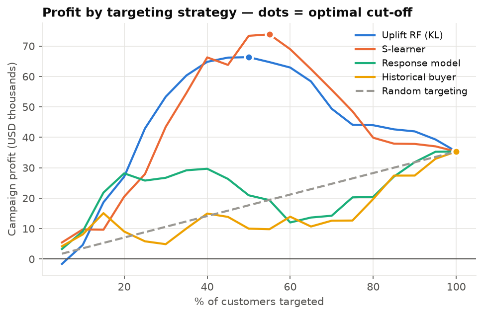
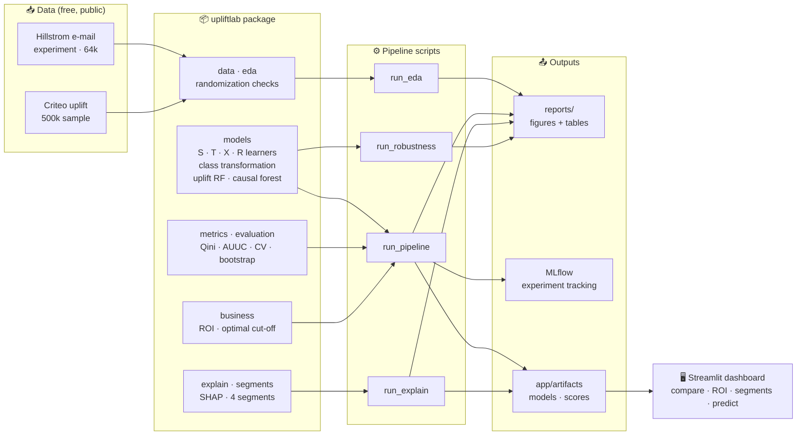

<div align="center">

# 🎯 Who Will Respond?
### Uplift modeling for targeted offers — send offers only to customers they actually persuade


**[Live demo](#-run-it)** · **[How it works](#-architecture)** · **[Results](#-key-results)** · **[📄 Full report (PDF)](reports/Uplift_Modeling_Report.pdf)** · **[Interview kit](docs/INTERVIEW.md)**

</div>

---

## 💡 The idea in 30 seconds

Most marketing models answer **"who will buy?"** — so they target people who would have bought *anyway*.
This project answers the question that actually makes money:

> **"Who will buy *because* we sent the offer?"**
> uplift(x) = P(buy | offer, x) − P(buy | no offer, x)

| | Buys without offer | Buys with offer | Decision |
|:--|:--:|:--:|:--|
| 🟢 **Persuadable** | ✗ | ✓ | **Target** — the offer creates the sale |
| 🔵 **Sure Thing** | ✓ | ✓ | Skip — paying for a sale you'd get anyway |
| ⚪ **Lost Cause** | ✗ | ✗ | Skip — wasted cost |
| 🟠 **Sleeping Dog** | ✓ | ✗ | **Never** — the offer drives them away |

---

## 🏆 Key results

<table>
<tr>
<td align="center" width="33%"><h2>~2×</h2>campaign profit vs mailing everyone<br><sub>$74k vs $35k per 100k customers</sub></td>
<td align="center" width="33%"><h2>−50%</h2>offers sent<br><sub>target the top half, skip the rest</sub></td>
<td align="center" width="33%"><h2>7 / 7</h2>uplift models beat every baseline<br><sub>the classic response model ≈ random</sub></td>
</tr>
</table>

- **"Predict who buys" fails.** A standard response model scored a Qini of **0.011** — statistically the same
  as random targeting (0.010). Uplift models reached **0.06–0.07**, with confidence intervals well above zero.
- **The model knows when to stop.** Above ~$3 per offer, the best plan is *not to run the campaign* — and the
  ROI simulator says so.
- **Who is persuadable?** Past buyers of women's products (the e-mail was the women's e-mail) gain **+8 pp**;
  high spenders and rural customers barely react. "Sure Things" identified by the model showed ~0 uplift on
  unseen data.
- **Honest robustness.** Results hold across 5 random splits and on 500k Criteo users — and where the
  effect is the same for everyone (men's e-mail), the models correctly find nothing to exploit.

<p align="center">


</p>
<p align="center"><sub><b>Left:</b> the uplift model finds the extra responders early; response models hug the random line.
<b>Right:</b> profit peaks when targeting ~50% of customers.</sub></p>

---

## 🏗 Architecture



**Design choices that matter**
- **One interface for every model** — `fit(X, y, t)` / `predict_uplift(X)` — so evaluation, ROI and the app
  treat a causal forest and a T-learner identically.
- **Meta-learners written from scratch** ([`models/meta.py`](src/upliftlab/models/meta.py), ~30 lines each),
  so every estimator can be explained line by line.
- **No leakage:** hyper-parameters chosen by cross-validation on training data only; the test set is touched once.
- **Profit is measured, not predicted:** uplift in each targeted slice comes from the randomized test set.
- **Lightweight deployment:** the app ships a small LightGBM model and needs none of the heavy causal libraries.

---

## 🧠 Methods

| Step | What | Why it matters |
|:--|:--|:--|
| **Validate the experiment** | covariate balance, propensity AUC = 0.50 | randomization is what makes uplift causal |
| **Baselines** | random, response model, "historical buyer" | proves *why* predicting purchases is the wrong question |
| **Meta-learners** | S, T, X, R on LightGBM | turn any ML model into a treatment-effect estimator |
| **Specialised uplift** | class transformation, uplift random forest, causal forest | purpose-built CATE estimators |
| **Evaluate** | Qini & uplift curves, AUUC, uplift@k, deciles, 5-fold CV, bootstrap CIs | individual uplift is never observed — rank-based metrics are the only honest test |
| **Decide** | profit vs % targeted, optimal cut-off, what-if on offer cost | turns scores into a business decision |
| **Explain** | SHAP on a surrogate model, segment profiles | tells marketing *who* to target and *why* |
| **Stress-test** | random seeds, second treatment arm, Criteo at scale | shows when uplift modeling works — and when it doesn't |

A teaching notebook — [`notebooks/03_causal_concepts.ipynb`](notebooks/03_causal_concepts.ipynb) — explains
ATE vs CATE, the four segments and the "fundamental problem of causal inference" with a simulated bank
where the true answer is known.

---

## 🖥 Dashboard

| Tab | What you can do |
|:--|:--|
| 📊 **Model comparison** | Qini / uplift curves for any models, results table, uplift by decile |
| 💰 **ROI simulator** | sliders for offer cost, profit per response, % targeted → profit, ROI, optimal cut-off |
| 🧩 **Segments** | size and *observed* behaviour of each segment, filter by channel and area |
| 🙋 **Should we send the offer?** | describe one customer → send / don't send, with SHAP reasons |

---

## 🚀 Run it

```bash
# Windows · Python 3.11 (causalml/econml have no reliable wheels for 3.13)
py -3.11 -m venv .venv
.venv\Scripts\activate
pip install -r requirements-lock.txt
pip install -e .

python scripts/run_eda.py          # data + randomization checks
python scripts/run_pipeline.py     # train, evaluate, ROI, MLflow  (~8 min, --fast skips uplift RF)
python scripts/run_explain.py      # SHAP + segments
python scripts/run_robustness.py   # seeds, men's arm, Criteo (downloads 311 MB once)
python scripts/build_report.py     # 15-page PDF report from the result tables

streamlit run app/streamlit_app.py
mlflow ui --backend-store-uri mlruns
```

**Deploy free on Streamlit Community Cloud:** New app → this repo → main file `app/streamlit_app.py` →
Advanced settings → Python 3.11. It installs the slim [`app/requirements.txt`](app/requirements.txt).
A [`Dockerfile`](Dockerfile) is included for Hugging Face Spaces.

<details>
<summary><b>📁 Project structure</b></summary>

```
uplift/
├── app/                  Streamlit dashboard + the small artifacts it loads
├── config/config.yaml    every seed, path, hyper-parameter and business assumption
├── docs/INTERVIEW.md     resume bullets, 2-minute pitch, likely questions
├── notebooks/            causal concepts explained with plots
├── reports/              all figures, result tables and the PDF report
├── scripts/              runnable pipeline steps
├── src/upliftlab/        reusable package (data, models, metrics, business, explain, ...)
└── tests/                pytest suite, incl. a headless test of the dashboard
```
</details>

---

## ⚠️ Limitations

- Hillstrom has few features and a modest effect, so the top models are statistically tied — the gap that
  matters is **uplift vs response modeling**, not between uplift models.
- "Website visit" is a proxy for "accepts the offer"; costs and margins are illustrative (change them in the app).
- Segment labels are model estimates — an individual's true segment is never observable.
- On Criteo, likely visitors were also the most persuadable, so a response model did equally well: always
  check that effects really differ between customers before investing in uplift modeling.

---

<div align="center">

**Lokesh Maan** · Causal ML capstone · [Interview kit & pitch](docs/INTERVIEW.md)

</div>
